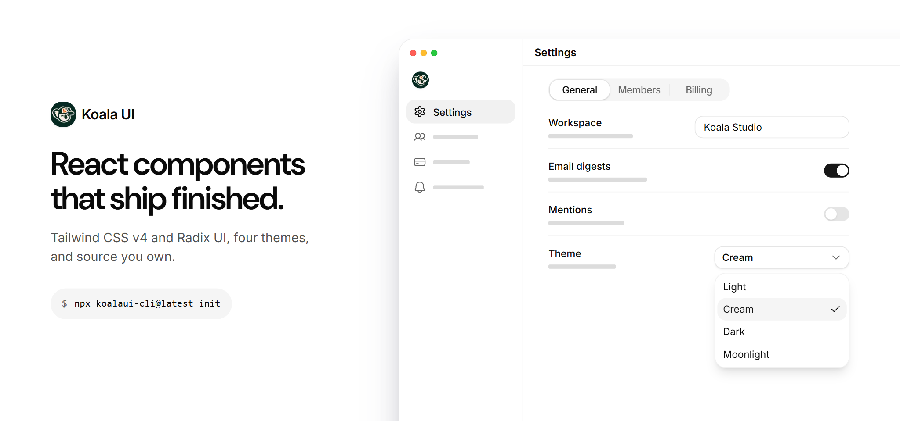
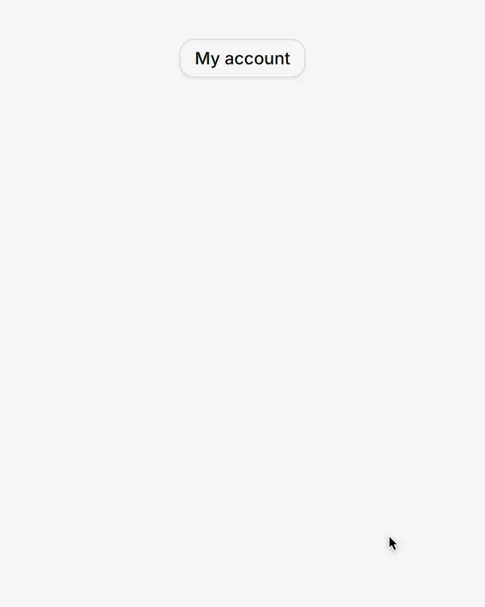
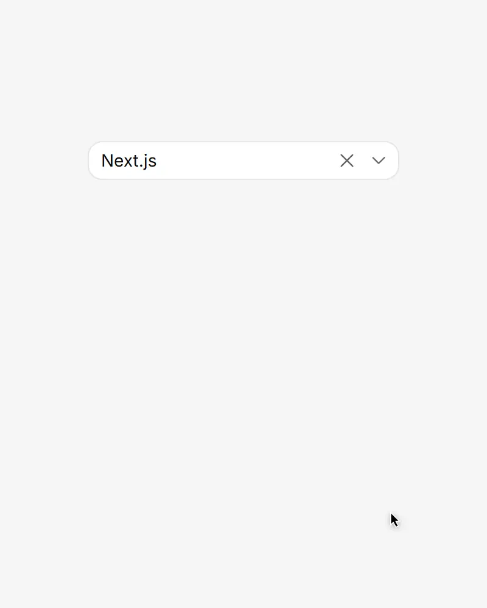
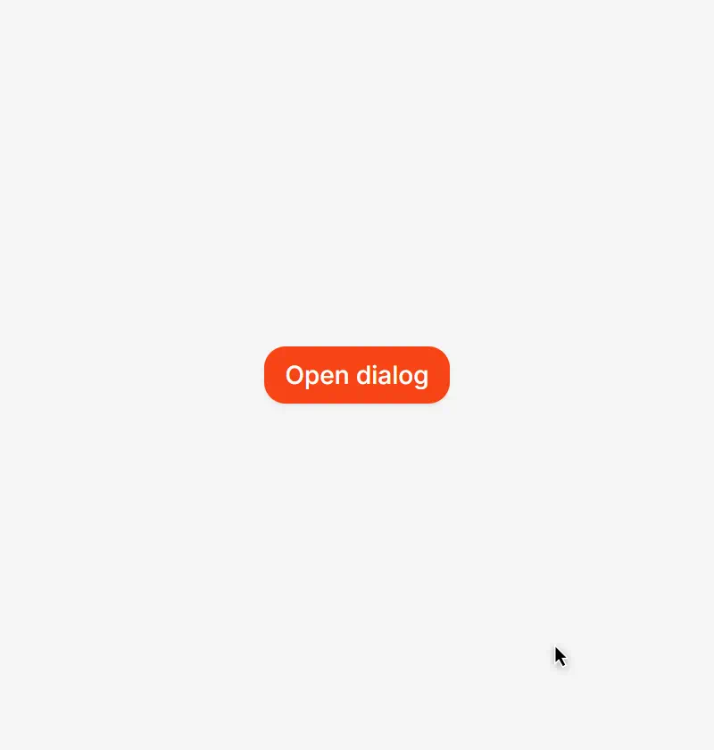
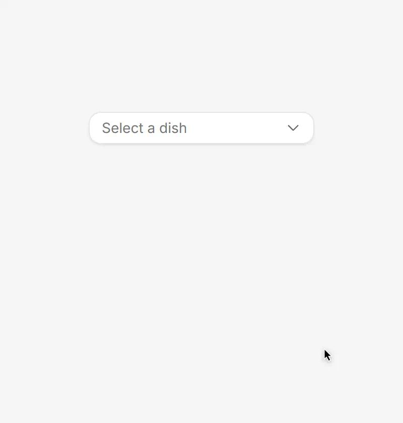
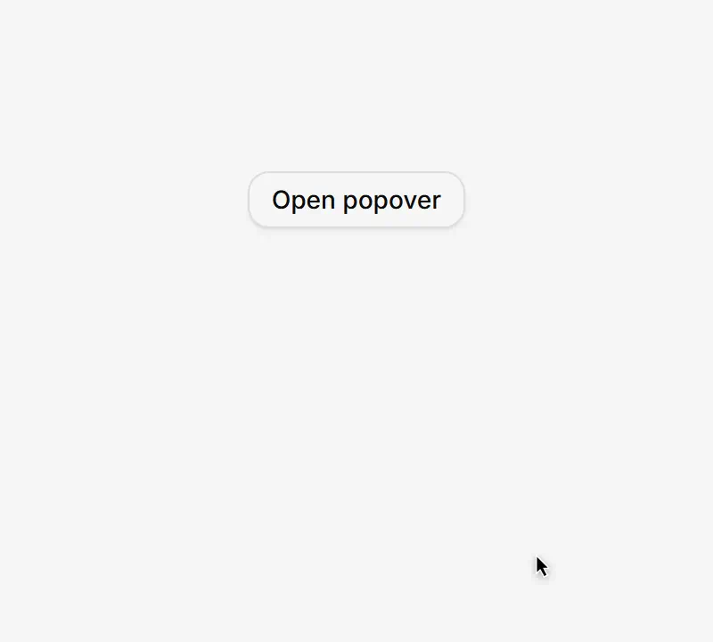
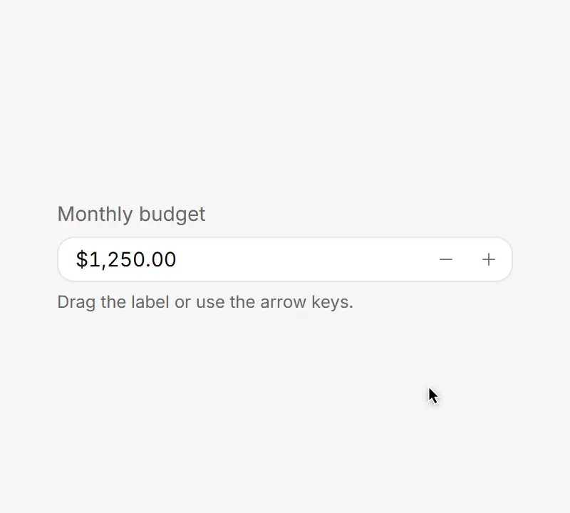
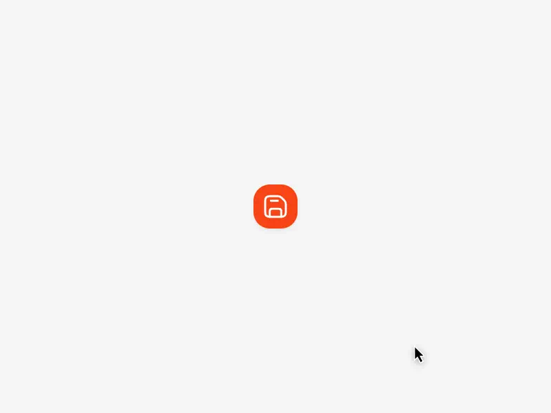
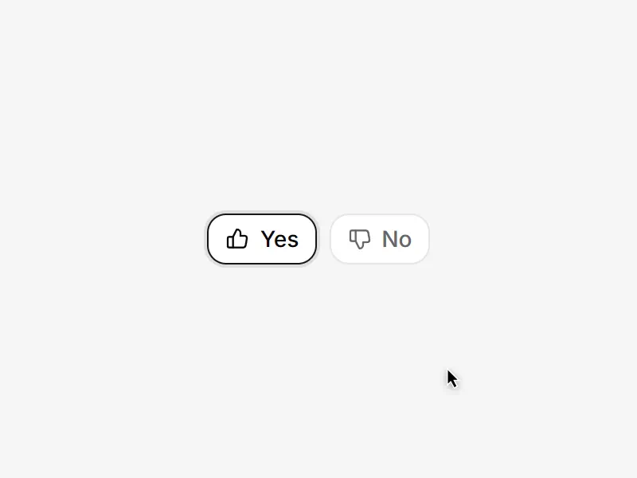

<p align="center">
  <a href="https://www.koalaui.com">
    <picture>
    <source media="(prefers-color-scheme: dark)" srcset="./.github/assets/banner-dark.png">
    
    </picture>
  </a>
</p>

<p align="center">
  <a href="./LICENSE"></a>
  <a href="https://www.npmjs.com/package/koalaui-cli"></a>
  
  
  
</p>

<p align="center">
  <a href="https://www.koalaui.com"><b>Website</b></a>
  &nbsp;·&nbsp;
  <a href="https://www.koalaui.com/docs"><b>Docs</b></a>
  &nbsp;·&nbsp;
  <a href="https://www.koalaui.com/docs/components"><b>Components</b></a>
  &nbsp;·&nbsp;
  <a href="#install"><b>Install</b></a>
  &nbsp;·&nbsp;
  <a href="https://www.koalaui.com/changelog"><b>Changelog</b></a>
  &nbsp;·&nbsp;
  <a href="https://www.koalaui.com/pro"><b>Pro</b></a>
</p>

**Koala UI is a React design system that ships finished.** Components on Tailwind CSS v4, Radix UI
and `tailwind-variants`, with four themes, accent presets and a density system. The CLI copies the
source into your project, so the code is yours to read and change, and Koala UI never becomes a
runtime dependency.

This repository is the **free tier**: 48 foundation components, the lib helpers and the
design tokens, all MIT.

## Showcase

The same live demos you find on each docs page, recorded from [koalaui.com](https://www.koalaui.com). Every
component below is free and installs from this repository.

<table>
<tr>
<td width="50%" valign="top">
<a href="https://www.koalaui.com/docs/components/dropdown-menu"><picture>
<source media="(prefers-color-scheme: dark)" srcset="./.github/assets/showcase/dropdown-menu-dark.webp">

</picture></a>
<br><a href="https://www.koalaui.com/docs/components/dropdown-menu"><b>Dropdown Menu</b></a><br>
<sub>Grouped actions, shortcuts and submenus</sub>
</td>
<td width="50%" valign="top">
<a href="https://www.koalaui.com/docs/components/combobox"><picture>
<source media="(prefers-color-scheme: dark)" srcset="./.github/assets/showcase/combobox-dark.webp">

</picture></a>
<br><a href="https://www.koalaui.com/docs/components/combobox"><b>Combobox</b></a><br>
<sub>Type to narrow a long list, then pick</sub>
</td>
</tr>
<tr>
<td width="50%" valign="top">
<a href="https://www.koalaui.com/docs/components/dialog"><picture>
<source media="(prefers-color-scheme: dark)" srcset="./.github/assets/showcase/dialog-dark.webp">

</picture></a>
<br><a href="https://www.koalaui.com/docs/components/dialog"><b>Dialog</b></a><br>
<sub>A focused task that keeps focus inside</sub>
</td>
<td width="50%" valign="top">
<a href="https://www.koalaui.com/docs/components/select"><picture>
<source media="(prefers-color-scheme: dark)" srcset="./.github/assets/showcase/select-dark.webp">

</picture></a>
<br><a href="https://www.koalaui.com/docs/components/select"><b>Select</b></a><br>
<sub>One choice from a list, keyboard first</sub>
</td>
</tr>
<tr>
<td width="50%" valign="top">
<a href="https://www.koalaui.com/docs/components/popover"><picture>
<source media="(prefers-color-scheme: dark)" srcset="./.github/assets/showcase/popover-dark.webp">

</picture></a>
<br><a href="https://www.koalaui.com/docs/components/popover"><b>Popover</b></a><br>
<sub>Rich content anchored to its trigger</sub>
</td>
<td width="50%" valign="top">
<a href="https://www.koalaui.com/docs/components/number-field"><picture>
<source media="(prefers-color-scheme: dark)" srcset="./.github/assets/showcase/number-field-dark.webp">

</picture></a>
<br><a href="https://www.koalaui.com/docs/components/number-field"><b>Number Field</b></a><br>
<sub>Step it, scrub it or type it</sub>
</td>
</tr>
<tr>
<td width="50%" valign="top">
<a href="https://www.koalaui.com/docs/components/tooltip"><picture>
<source media="(prefers-color-scheme: dark)" srcset="./.github/assets/showcase/tooltip-dark.webp">

</picture></a>
<br><a href="https://www.koalaui.com/docs/components/tooltip"><b>Tooltip</b></a><br>
<sub>A short hint on hover and on focus</sub>
</td>
<td width="50%" valign="top">
<a href="https://www.koalaui.com/docs/components/toggle-group"><picture>
<source media="(prefers-color-scheme: dark)" srcset="./.github/assets/showcase/toggle-group-dark.webp">

</picture></a>
<br><a href="https://www.koalaui.com/docs/components/toggle-group"><b>Toggle Group</b></a><br>
<sub>One or many options from a row</sub>
</td>
</tr>
</table>

## Why Koala UI

- **Source you own.** `add` writes the component into `components/ui/`. Edit it like your own code; there is no package to fork.
- **Accessible underneath.** Focus, keyboard and ARIA come from Radix UI primitives, so menus, dialogs and selects behave the way people expect.
- **Four themes from one set of tokens.** Light, cream, dark and moonlight, plus accent presets and one radius knob. Semantic color roles mean a component never hard-codes a color.
- **Two densities.** `comfortable` for marketing pages, `compact` for dense app screens, from the same components.
- **Updates that respect your edits.** `diff` shows what changed upstream and what you touched; `update` replaces untouched files and keeps yours.
- **Ready for coding agents.** An agent skill with one reference per component, every docs page as markdown, and an `llms.txt` index.

## Install

Requires **React 19** and **Tailwind CSS v4**, in Next.js or Vite.

```bash
npx koalaui-cli@latest init                      # tokens, helpers, theme provider, base deps
npx koalaui-cli@latest add button dialog select  # components, their dependencies pulled along
npx koalaui-cli@latest list                      # everything you can add
```

`init` detects Next.js or Vite, finds the stylesheet that imports Tailwind and wires the tokens
into it. Later, `npx koalaui-cli@latest diff` and `update` keep you current. The full guide,
including the move from another component setup, is at
[koalaui.com/docs/installation](https://www.koalaui.com/docs/installation).

## Usage

```tsx
import { Button } from "@/components/ui/button"
import {
  DropdownMenu,
  DropdownMenuContent,
  DropdownMenuItem,
  DropdownMenuSeparator,
  DropdownMenuTrigger,
} from "@/components/ui/dropdown-menu"

export function AccountMenu() {
  return (
    <DropdownMenu>
      <DropdownMenuTrigger asChild>
        <Button variant="outline">My account</Button>
      </DropdownMenuTrigger>
      <DropdownMenuContent>
        <DropdownMenuItem>Profile</DropdownMenuItem>
        <DropdownMenuItem>Settings</DropdownMenuItem>
        <DropdownMenuSeparator />
        <DropdownMenuItem variant="destructive">Log out</DropdownMenuItem>
      </DropdownMenuContent>
    </DropdownMenu>
  )
}
```

Every part is a named export, so it works across the React Server Components boundary, and every
part takes `className`, merged last.

## Components

The 48 free components. Each links to its docs page: live examples, every variant and the API.

<table>
<tr><td width="25%"><a href="https://www.koalaui.com/docs/components/accordion">Accordion</a></td><td width="25%"><a href="https://www.koalaui.com/docs/components/alert">Alert</a></td><td width="25%"><a href="https://www.koalaui.com/docs/components/animated-label">Animated Label</a></td><td width="25%"><a href="https://www.koalaui.com/docs/components/avatar">Avatar</a></td></tr>
<tr><td width="25%"><a href="https://www.koalaui.com/docs/components/avatar-group">Avatar Group</a></td><td width="25%"><a href="https://www.koalaui.com/docs/components/badge">Badge</a></td><td width="25%"><a href="https://www.koalaui.com/docs/components/breadcrumb">Breadcrumb</a></td><td width="25%"><a href="https://www.koalaui.com/docs/components/button">Button</a></td></tr>
<tr><td width="25%"><a href="https://www.koalaui.com/docs/components/button-group">Button Group</a></td><td width="25%"><a href="https://www.koalaui.com/docs/components/card">Card</a></td><td width="25%"><a href="https://www.koalaui.com/docs/components/checkbox">Checkbox</a></td><td width="25%"><a href="https://www.koalaui.com/docs/components/code-snippet">Code Snippet</a></td></tr>
<tr><td width="25%"><a href="https://www.koalaui.com/docs/components/collapsible">Collapsible</a></td><td width="25%"><a href="https://www.koalaui.com/docs/components/combobox">Combobox</a></td><td width="25%"><a href="https://www.koalaui.com/docs/components/context-menu">Context Menu</a></td><td width="25%"><a href="https://www.koalaui.com/docs/components/dialog">Dialog</a></td></tr>
<tr><td width="25%"><a href="https://www.koalaui.com/docs/components/divider">Divider</a></td><td width="25%"><a href="https://www.koalaui.com/docs/components/drawer">Drawer</a></td><td width="25%"><a href="https://www.koalaui.com/docs/components/dropdown-menu">Dropdown Menu</a></td><td width="25%"><a href="https://www.koalaui.com/docs/components/field">Field</a></td></tr>
<tr><td width="25%"><a href="https://www.koalaui.com/docs/components/hover-card">Hover Card</a></td><td width="25%"><a href="https://www.koalaui.com/docs/components/input">Input</a></td><td width="25%"><a href="https://www.koalaui.com/docs/components/input-group">Input Group</a></td><td width="25%"><a href="https://www.koalaui.com/docs/components/kbd">Kbd</a></td></tr>
<tr><td width="25%"><a href="https://www.koalaui.com/docs/components/label">Label</a></td><td width="25%"><a href="https://www.koalaui.com/docs/components/link">Link</a></td><td width="25%"><a href="https://www.koalaui.com/docs/components/menubar">Menubar</a></td><td width="25%"><a href="https://www.koalaui.com/docs/components/native-select">Native Select</a></td></tr>
<tr><td width="25%"><a href="https://www.koalaui.com/docs/components/number-field">Number Field</a></td><td width="25%"><a href="https://www.koalaui.com/docs/components/pagination">Pagination</a></td><td width="25%"><a href="https://www.koalaui.com/docs/components/popover">Popover</a></td><td width="25%"><a href="https://www.koalaui.com/docs/components/progress">Progress</a></td></tr>
<tr><td width="25%"><a href="https://www.koalaui.com/docs/components/prose">Prose</a></td><td width="25%"><a href="https://www.koalaui.com/docs/components/radio-group">Radio Group</a></td><td width="25%"><a href="https://www.koalaui.com/docs/components/scroll-area">Scroll Area</a></td><td width="25%"><a href="https://www.koalaui.com/docs/components/select">Select</a></td></tr>
<tr><td width="25%"><a href="https://www.koalaui.com/docs/components/sheet">Sheet</a></td><td width="25%"><a href="https://www.koalaui.com/docs/components/skeleton">Skeleton</a></td><td width="25%"><a href="https://www.koalaui.com/docs/components/slider">Slider</a></td><td width="25%"><a href="https://www.koalaui.com/docs/components/spinner">Spinner</a></td></tr>
<tr><td width="25%"><a href="https://www.koalaui.com/docs/components/stepper">Stepper</a></td><td width="25%"><a href="https://www.koalaui.com/docs/components/switch">Switch</a></td><td width="25%"><a href="https://www.koalaui.com/docs/components/tabs">Tabs</a></td><td width="25%"><a href="https://www.koalaui.com/docs/components/textarea">Textarea</a></td></tr>
<tr><td width="25%"><a href="https://www.koalaui.com/docs/components/toast">Toast</a></td><td width="25%"><a href="https://www.koalaui.com/docs/components/toggle">Toggle</a></td><td width="25%"><a href="https://www.koalaui.com/docs/components/toggle-group">Toggle Group</a></td><td width="25%"><a href="https://www.koalaui.com/docs/components/tooltip">Tooltip</a></td></tr>
</table>

## For coding agents

`npx koalaui-cli@latest skill` writes the Koala UI agent skill ([skills/koala-ui](./skills/koala-ui))
into `.claude/skills/koala-ui/`: the house rules plus one reference per component, generated from
the docs. Every docs page is also served as markdown at its URL plus `.md`, indexed by
[llms.txt](https://www.koalaui.com/llms.txt).

## Free and Pro

| Tier | What | Install |
| --- | --- | --- |
| **Free** | the 48 foundation components, lib helpers, tokens | `npx koalaui-cli@latest add <name>`, no account |
| **Pro** | the other 139 components, every section, page examples, templates | a license, then `npx koalaui-cli@latest login <key>` |

Pro source lives in a private repository and reaches buyers through the licensing API, so a
license is the only thing that grants access. [See the plans](https://www.koalaui.com/pro).

## Contributing

Bug reports, ideas and pull requests are welcome. Read [CONTRIBUTING.md](./CONTRIBUTING.md) first:
it covers how this repository is published, the local setup and the rules every component follows.

## License

Everything in this repository is [MIT](./LICENSE): the free components, the helpers, the tokens
and the `koalaui` CLI. Use it, change it and ship it in anything, commercial or not.

Koala UI Pro is a commercial license and its source is not in this repository. See the
[License Agreement](https://www.koalaui.com/legal/license).
